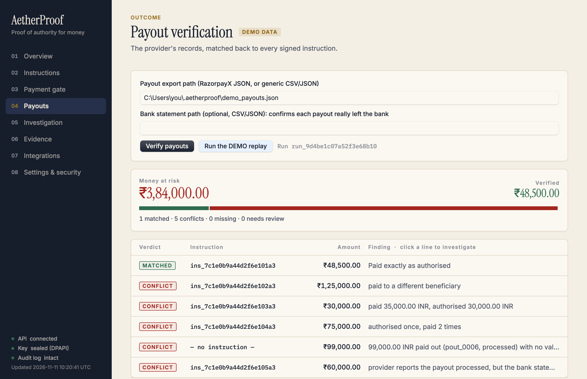

# AetherProof

**Stop payouts nobody approved.**

For NBFCs and lenders that disburse loans through payout APIs (RazorpayX, Cashfree, bank
APIs). AetherProof checks every payout against a signed sanction before money leaves:
right borrower, right account, right amount, paid once. Then it matches every payout to the
bank statement, so nothing unapproved waits a week to be found.

Status: **0.5.2, evaluation build.** Tested on synthetic data only. No production
deployment, no live provider or bank connector yet, no independent security audit, no
regulatory certification.

**Website and early access:** https://aetherproof.vercel.app/

## The problem

Lenders in India are losing crores through their own payout integrations. An attacker gets
into a lending server, calls the payout API with the lender's real keys from the lender's
own allowed IP address, and swaps borrowers' accounts for mule accounts. API keys, IP allow
lists and provider side approval all see a valid call. Weekly reconciliation finds the loss
days later, after the money has moved on, while the first hours decide whether it can still
be frozen.

## How it works

1. **Sanction.** The loan system signs loan, amount and account when the loan is approved.
2. **Gate.** AetherProof checks signature, amount, account, validity window and first use.
   Anything else is refused. If it cannot decide, nothing is paid.
3. **Payout.** Only checked payouts reach the provider.
4. **Bank.** Provider status and the bank statement are matched back to the sanction.

A signature from a hacked loan server proves nothing on its own, so the gate is being
extended to check facts that server cannot create (see the status table).

## What is built and what is not

| Capability | Status |
|---|---|
| Signed payout approval (Ed25519): amount, currency, account, validity window | Built |
| Fail closed gate; each approval pays at most once (replay store) | Built |
| Refuses changed amount, changed account, unknown reference, repeat | Built |
| Payout reconciliation: RazorpayX shaped and generic CSV / JSON exports | Built, from files |
| Bank statement check: "processed" but never debited is a conflict | Built, from files |
| Signed evidence packages an auditor verifies offline | Built |
| Hash chained log, signed checkpoints, RFC 3161 time stamps | Built |
| Local API `/api/v1` with roles, lockout, rate limit, audit log; desktop app | Built, local only |
| Bank accounts stored as salted hashes, not raw numbers | Built |
| Provider keys held only by the gate (live RazorpayX / Cashfree client) | In development |
| Shadow mode: every reported payout matched to a gate decision, alert in minutes | In development |
| Freeze request with UTRs and receiving account, for the 1930 helpline and the bank | In development |
| Pay only to the account on the borrower's own repayment mandate | In development |
| Second approver for account changes and large payouts | In development |
| Limits, velocity checks, emergency pause, safe float advice | In development |
| Incident pack, early warning signal mapping | In development |
| Cloud key store, two or more gate instances, self hosted deployment package | In development |

## Requirements it is built around

We do not claim certification or compliance. These are the requirements lenders are asked
to meet and what AetherProof does about each today.

| Requirement | Source | AetherProof today |
|---|---|---|
| Validate every payout against approved records; refuse unknown references | National cyber agency advisory on payout APIs, Oct 2026 (as summarised in the press) | Built: gate refuses unknown, changed or repeated payouts |
| Disburse only to the borrower's own account | RBI Digital Lending Directions, 2025 | Partly: account bound into the signed approval; mandate rule in development |
| Per payout and per day limits at the API layer | Same advisory (as summarised) | In development |
| Catch it while money can still be frozen | 1930 helpline practice | In development: shadow mode and freeze request |
| Report cyber incidents within 6 hours; keep logs 180 days in India | CERT-In directions, April 2022 | Partly: tamper evident signed logs on your machines; incident pack in development |
| Early warning signals and staff accountability | RBI fraud risk management directions for NBFCs | Partly: every approval names its signer |
| Light vendor review under outsourcing rules | RBI IT outsourcing directions for NBFCs, Nov 2025 | Runs on your machines; no vendor access to data |
| Instant loans stay instant | Your business | Gate decision about 1.2 ms median (see Tests) |
| Keep personal data to a minimum | DPDP Act | Accounts stored as salted hashes |

## Install

```bash
git clone https://github.com/pulkit6732/aetherproof
cd aetherproof
pip install -e ".[timestamp]"
```

`pip install aetherproof` currently installs 0.5.1 from PyPI, which does not have the
payout features.

## Quick start

```bash
# approver: sign what was approved
aetherproof instruction sign --amount 48500.00 --currency INR --beneficiary-token fa_123 \
    --reference LN-1041 --approval-ref SAN-7701 --approved-by credit-ops

# executor: check before paying (exit 0 = allow, 1 = reject)
aetherproof instruction verify ~/.aetherproof/instructions/<id>.json \
    --amount 48500.00 --currency INR --beneficiary-token fa_123 --reference <id>

# afterwards: provider export and bank statement against the approvals
aetherproof payouts reconcile payouts.json --instructions ~/.aetherproof/instructions \
    --source razorpayx --statement statement.csv

# auditor: offline tamper check of a signed evidence package
aetherproof evidence verify run.evidence.json --pubkey signing_key.pub

# local API for the desktop app
aetherproof serve
```

Real output for one approval and four payout attempts (synthetic loan, 23 Nov 2026):

```text
same amount, same account, first use   ALLOW  authorised, unchanged, first use.        exit 0
account swapped                        REJECT beneficiary differs from the authorised one  exit 1
amount 84,500.00 instead of 48,500.00  REJECT amount differs from authorised           exit 1
same payout sent again                 REJECT instruction already used (replay)        exit 1
```

The [user guide](https://github.com/pulkit6732/aetherproof/blob/main/docs/USER_GUIDE.md)
covers the demo, the daily workflow, file formats and how an auditor checks evidence.

## What it does not do

Full list: [CLAIMS.md](https://github.com/pulkit6732/aetherproof/blob/main/docs/CLAIMS.md).

| Not covered | Why |
|---|---|
| Payouts that skip the gate | Until the gate holds the only provider keys and shadow mode watches every payout, a call from elsewhere is not checked |
| A stolen signing key | Whoever holds it can sign; keep it in a separate key store, with limits and a second approver |
| A fully fake borrower | If the attacker creates the borrower too, the name matches; the mandate rule and limits reduce this, they do not remove it |
| Whether a loan was a good decision | A signature proves what was approved and by whom, not that it was right |
| Authentic bank data | Statements are imported files today, not authenticated feeds |
| One insider forging both the provider export and the statement | Two forged files that agree stay consistent |
| That every event was logged | The log proves integrity, not completeness |

## Desktop app

`app/` is a desktop client for the local API, built with
[Rune](https://github.com/anomalyco/rune). Screens: Overview, Instructions, Payment gate,
Payouts, Transaction investigation, Evidence, Integrations, Settings and security.

Rune is pre release, so the app builds against a local checkout placed next to this
repository, at `../vendor/rune` from the repository root, pinned to rev `ba5e7c80`. Then
run `aetherproof serve` and `cargo run --release` in `app/`. Every screen also renders
headless: `aetherproof-app --scene payouts --snap payouts.png`.



## Also in this repository

* **Action reconciliation** against AWS CloudTrail, for automated actions that are not
  payouts ([RECONCILIATION.md](https://github.com/pulkit6732/aetherproof/blob/main/docs/RECONCILIATION.md)).
* **Receipts**, the original SDK: signed records of a prompt and output pair, verified
  offline with one dependency ([GETTING-STARTED.md](https://github.com/pulkit6732/aetherproof/blob/main/docs/GETTING-STARTED.md),
  [VERIFICATION.md](https://github.com/pulkit6732/aetherproof/blob/main/docs/VERIFICATION.md)).
* **A Rust core** in `rust/`: Ed25519, plus ML-DSA-65 (FIPS 204), secret wiping and
  constant time compare. Optional; the Python package does not import it, which CI enforces.
  Its 128 byte receipt is a legacy format whose hash fields are 64 bit FNV-1a checksums,
  not cryptographic hashes; see CLAIMS.md.

## Tests

Local results on Windows, synthetic data only, not production accuracy. Rerun before
quoting.

* Python suite, 23 Nov 2026: 904 passed, 0 skipped, on a fresh clone of `main`
  (`python -m pytest tests/`). CI runs it on Linux, macOS and Windows, Python 3.9, 3.11, 3.13.
* Gate speed, 23 Nov 2026: 2,000 allowed payouts through `verify_instruction` with the
  durable replay store: 1.18 ms median, 1.46 ms at the 99th percentile, one process on a
  laptop.
* Rust core, 18 Nov 2026: 62 passed (`cargo test --release --workspace` in `rust/`).
* Attack lab, 12 Nov 2026, 100k payouts: 0 of 94,400 clean payouts flagged; forged
  "processed" status caught 500 of 500 with the statement (`python bench/attack_lab.py 100000`).
* Unknown attack fuzz, 12 Nov 2026: 0 fail open in 60,000 mutated cases
  (`python bench/unknown_attacks.py 60000`).

## Documentation

| | |
|---|---|
| [USER_GUIDE.md](https://github.com/pulkit6732/aetherproof/blob/main/docs/USER_GUIDE.md) | install, demo, workflow, file formats |
| [SIGNED-INSTRUCTION-SPEC.md](https://github.com/pulkit6732/aetherproof/blob/main/docs/SIGNED-INSTRUCTION-SPEC.md) | approval format, gate, payout checks |
| [API_CONTRACT.md](https://github.com/pulkit6732/aetherproof/blob/main/docs/API_CONTRACT.md) | local API `/api/v1` |
| [RECONCILIATION.md](https://github.com/pulkit6732/aetherproof/blob/main/docs/RECONCILIATION.md) | CloudTrail, checkpoints, RFC 3161 time |
| [CLAIMS.md](https://github.com/pulkit6732/aetherproof/blob/main/docs/CLAIMS.md) | what this proves and what it does not |
| [SECURITY.md](https://github.com/pulkit6732/aetherproof/blob/main/SECURITY.md) | reporting a vulnerability, threat model |
| [ROADMAP.md](https://github.com/pulkit6732/aetherproof/blob/main/docs/ROADMAP.md) | what is planned |
| [CONTRIBUTING.md](https://github.com/pulkit6732/aetherproof/blob/main/CONTRIBUTING.md) | how to contribute |

## License

Apache-2.0. Versions up to 0.2.2 were AGPL-3.0-or-later.

Security issues: see [SECURITY.md](https://github.com/pulkit6732/aetherproof/blob/main/SECURITY.md). Please do not open a public issue.
